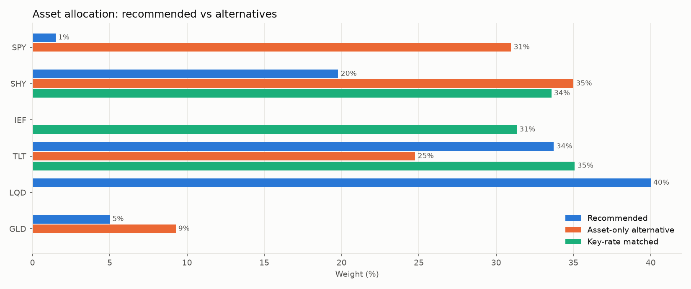
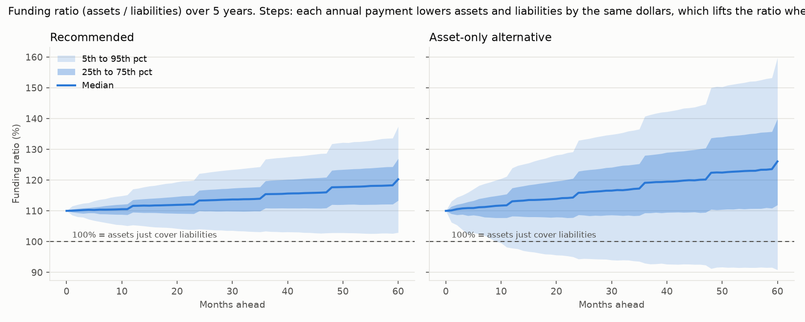
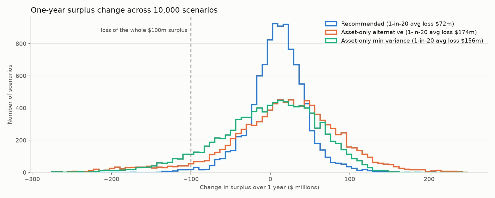

# Illustrative portfolio review: synthetic annuity insurer

This is an ILLUSTRATIVE report for a SYNTHETIC insurer built for a portfolio project. It is not
investment advice, and the capital figures are a simplified PROXY, not NAIC risk-based capital.

Starting position: assets $1,100.0m, liabilities $1,000.0m (a block of payout annuities paying
for 30 years), surplus $100.0m, funding ratio 110%. Data through
September 2026.

## Summary

- Recommended allocation: LQD 40.0%, TLT 33.7%, SHY 19.8%, GLD 5.0%, SPY 1.5%.
- Against an asset-only portfolio built to maximize return per unit of asset risk, it cuts the
  one-year surplus volatility from $72.9m to $34.7m, and the average
  loss in the worst 1-in-20 year from $173.6m to $71.5m.
- Capital used (proxy) falls from $175.3m to $33.5m; surplus covers
  the proxy 3.0 times (minimum required here: 2.0).
- Expected surplus growth: $10.0m a year (target $10.0m), versus
  $16.7m for the asset-only portfolio, which takes far more surplus risk.
- After 5 years the median funding ratio is 120%; in the worst 5% of
  scenarios it is 103% or lower.
- Liquidity: liquid assets after a severe stress cover a year of payments plus a 10% surrender wave
  4.5 times.

|                        |   Exp. surplus change $m |   Surplus vol $m |   1-in-20 avg loss $m |   Capital proxy $m |   Coverage x |   Liquidity coverage x | Funding ratio 5y median   | Funding ratio 5y p05   |
|:-----------------------|-------------------------:|-----------------:|----------------------:|-------------------:|-------------:|-----------------------:|:--------------------------|:-----------------------|
| Recommended (banded)   |                    10    |            34.67 |                 71.53 |              33.52 |         2.98 |                   4.53 | 120.3%                    | 103.0%                 |
| Without band           |                    10    |            33.05 |                 65.84 |              31.77 |         3.15 |                   4.59 | 119.9%                    | 104.0%                 |
| Asset-only alternative |                    16.67 |            72.92 |                173.65 |             175.32 |         0.57 |                   4.03 | 126.1%                    | 90.8%                  |
| Key-rate matched       |                     4.47 |            10.65 |                 20.92 |               2.29 |        43.74 |                   5.22 | 116.5%                    | 110.0%                 |

## Why surplus, not assets

The insurer's real risk is the gap between assets and the promises they back. The lowest-risk
portfolio judged on assets alone (almost all short-term Treasuries) looks safe, but its value barely
moves when interest rates fall while the liabilities rise sharply. Its worst 1-in-20 year costs
$155.5m of surplus on average, more than the whole $100.0m surplus. Matching the
liabilities' interest rate sensitivity with Treasuries alone cuts that to
$20.9m.

## Credit: what the optimizer did

Because the liabilities are valued on the Treasury curve, credit spreads add risk to surplus without a
matching offset. Left free, the optimizer holds no corporate credit (surplus volatility
$20.1m). Under the insurer-style rule of at least 40% investment grade credit, it holds
exactly the minimum 40% and no more; that floor raises surplus volatility to $33.1m
(before the duration band, which adds a little more, see below).
Insurers hold credit for spread income, hold-to-maturity accounting and liability discounting rules
that this simplified model does not capture, so the floor is a policy choice to review, not a result
of the optimization.

## Interest rate position: kept within a band, and why

The recommended portfolio keeps the gap between asset and liability interest rate sensitivity within
plus or minus $10m of surplus per 1 point move in rates. Its asset duration is
9.5 years against the 8.6 needed for an exact match, so
surplus moves about $10.0m for each 1 point fall in rates.

Without that band, the optimizer would run a much longer duration (surplus gap $20.3m per 1
point), because in history Treasury prices tended to rise when credit sold off, so extra Treasuries
offset losses on the 40% credit holding. That relationship broke in 2022, when rates rose and credit
spreads widened together. The band trades a little historical efficiency for robustness:
- Cost: surplus volatility $34.7m vs $33.1m without the band, and a
  1-in-20 average loss of $71.5m vs $65.8m.
- Benefit: a +100bp rate rise costs $7.7m instead of
  $16.8m; a 2022-style rise in rates plus a 100bp investment grade spread
  widening costs about $42.6m instead of $51.7m.

## Stress and regime view

Interest rate shocks (surplus change): parallel +100bp -$7.7m, parallel
-100bp $13.0m, steepener -$3.5m, flattener
$3.7m. Credit spread shocks: IG +100bp -$34.9m,
HY +400bp $0.0m. The largest single loss is from the IG spreads +100bp shock
(-$34.9m).

Replaying 2007 to 2026 history month by month: in rising-rate months surplus changed by
$7.9m a year on average, in falling-rate
months $8.8m; in high-volatility months
$30.7m, in low-volatility months
$2.0m. On average the weakest
environment is low volatility
months; the worst single month was -$50.0m, in a falling
rates month. These are in-sample
replays: the portfolio was built with knowledge of this history.

## Key risks and caveats

- Synthetic liabilities, fixed and nominal, with no policyholder behavior beyond the surrender test.
- Capital is a simplified proxy, not NAIC RBC. Factors are assumptions.
- Expected returns: bonds use today's yields, equities use long-run historical estimates.
- Scenarios replay 2007 to 2026 history; nothing worse than that period can appear.
- The rate outlook matters little for this portfolio because its interest rate gap is capped: the
  5-year median funding ratio is 120.3% with rates drifting toward market forward
  rates, 120.1% if today's curve holds, and 119.6% if rates return
  toward their 2007 to 2026 average.
- ETFs stand in for the bonds and loans an insurer would hold directly.

## Recommended actions

1. Move toward the recommended allocation, away from asset-only portfolios that leave surplus exposed
   to falling rates.
2. Adopt the duration-gap band (plus or minus $10m of surplus per 100bp) in the investment policy and
   re-check the gap monthly.
3. Review the 40% credit floor with the investment committee: it is the main source of remaining
   surplus volatility in this model.
4. Hold at least the current level of Treasuries as the liquidity buffer for surrender spikes.
5. Before relying on these figures, replace the capital proxy with the insurer's actual capital model
   and the synthetic liabilities with real cash flows.

