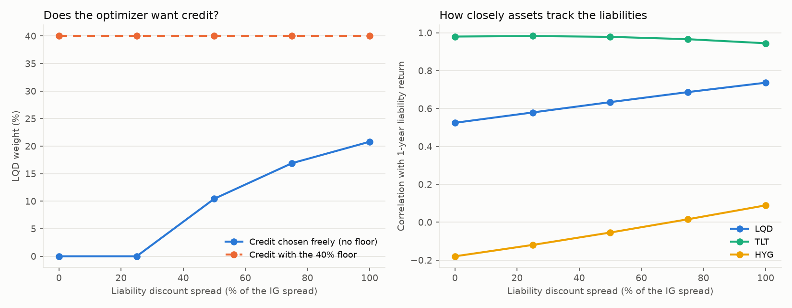

# Liability discount-rate variant

Generated by `python -m engine.run_discount_variant`. $ millions. Liabilities discounted at the Treasury zero curve plus a share of the investment grade spread (today's ICE IG OAS 0.84%), as an illiquidity premium. Recommended assumption: 50% of the IG spread (42bp); 0% is the Stage 3 base case. In the scenarios the add-on moves with the simulated IG spread (same historical months as the asset returns). Same cash flows in every variant. For the optimization, assets are set to 110% of each variant's liability value so the risk budget is comparable; 'funding_ratio_assets_1100' shows the pure valuation effect with assets fixed at 1,100.

## Liability value, duration and how assets track it

`discount_spread` in bp; `liability_spread_dv01` = $m change for 1bp of discount spread.

| fraction_of_IG   |   discount_spread |   liability_pv |   liability_effective_duration |   liability_macaulay |   liability_dv01 |   liability_spread_dv01 |   funding_ratio_assets_1100 |   corr_LQD_vs_liability |   corr_HYG_vs_liability |   corr_TLT_vs_liability |
|:-----------------|------------------:|---------------:|-------------------------------:|---------------------:|-----------------:|------------------------:|----------------------------:|------------------------:|------------------------:|------------------------:|
| 0%               |                 0 |       1000     |                         9.4821 |               9.7333 |           0.9482 |                  0.9539 |                      1.1    |                  0.525  |                 -0.1797 |                  0.9802 |
| 25%              |                21 |        980.283 |                         9.369  |               9.6196 |           0.9184 |                  0.9241 |                      1.1221 |                  0.5795 |                 -0.1196 |                  0.9829 |
| 50%              |                42 |        961.181 |                         9.2575 |               9.5073 |           0.8898 |                  0.8954 |                      1.1444 |                  0.6341 |                 -0.0541 |                  0.9786 |
| 75%              |                63 |        942.668 |                         9.1476 |               9.3965 |           0.8623 |                  0.8679 |                      1.1669 |                  0.6871 |                  0.016  |                  0.9662 |
| 100%             |                84 |        924.722 |                         9.0392 |               9.2873 |           0.8359 |                  0.8414 |                      1.1895 |                  0.7366 |                  0.0893 |                  0.9447 |

## Re-optimized portfolios under each variant (same constraints, capital proxy and duration band)

`free` = surplus-aware optimizer WITHOUT the 40% credit floor (what it chooses on its own); `headline` = with the floor (the recommended rule). `IG_shock_surplus_change` = surplus change if IG spreads widen 100bp (assets: LQD revaluation; liabilities: discount spread rises by the same share of 100bp).

| fraction_of_IG   |   free_LQD |   free_TLT |   free_SHY |   free_IEF |   free_GLD |   free_SPY |   free_surplus_vol |   free_CVaR95 |   free_capital |   free_IG_shock_surplus_change | free_status                                              |   headline_LQD |   headline_TLT |   headline_SHY |   headline_IEF |   headline_GLD |   headline_SPY |   headline_surplus_vol |   headline_CVaR95 |   headline_capital |   headline_IG_shock_surplus_change | headline_status                                          |
|:-----------------|-----------:|-----------:|-----------:|-----------:|-----------:|-----------:|-------------------:|--------------:|---------------:|-------------------------------:|:---------------------------------------------------------|---------------:|---------------:|---------------:|---------------:|---------------:|---------------:|-----------------------:|------------------:|-------------------:|-----------------------------------:|:---------------------------------------------------------|
| 0%               |     0      |     0.4836 |     0.41   |      0     |     0.05   |     0.0564 |            20.0533 |       36.668  |        36.1012 |                         0      | target met                                               |            0.4 |         0.3373 |         0.1978 |              0 |           0.05 |         0.0149 |                34.6734 |           71.5291 |            33.5182 |                           -34.934  | target met                                               |
| 25%              |     0      |     0.4215 |     0.5098 |      0     |     0.0343 |     0.0343 |            11.5271 |       17.614  |        22.9161 |                        23.102  | target met                                               |            0.4 |         0.3148 |         0.2852 |              0 |           0    |         0      |                24.7831 |           47.2549 |            10.8328 |                           -11.1432 | target met                                               |
| 50%              |     0.1045 |     0.3319 |     0.5097 |      0.038 |     0.0142 |     0.0018 |             8.067  |        7.8163 |        11.076  |                        35.9962 | target met                                               |            0.4 |         0.2788 |         0.3212 |              0 |           0    |         0      |                20.3281 |           35.0691 |             6.4598 |                            11.1935 | target below min-variance return: min-variance portfolio |
| 75%              |     0.1691 |     0.3031 |     0.5197 |      0     |     0.0081 |     0      |             9.055  |        6.7965 |        10.6503 |                        51.1702 | target below min-variance return: min-variance portfolio |            0.4 |         0.2531 |         0.3469 |              0 |           0    |         0      |                16.975  |           25.5543 |             4.1477 |                            32.1606 | target below min-variance return: min-variance portfolio |
| 100%             |     0.2081 |     0.275  |     0.5007 |      0     |     0.0049 |     0.0113 |            10.5582 |        7.256  |        14.5616 |                        67.3366 | target below min-variance return: min-variance portfolio |            0.4 |         0.2285 |         0.3715 |              0 |           0    |         0      |                14.8855 |           18.8827 |             5.7365 |                            51.8375 | target below min-variance return: min-variance portfolio |

## Reading

- Liability PV falls from 1000.0 (Treasury) to 961.2 at 50% of IG and 924.7 at 100%; funding ratio with assets fixed at 1,100 rises from 110.0% to 114.4% and 119.0%.
- Correlation of LQD with the liability return: 0.52 at 0% vs 0.63 at 50% and 0.74 at 100%.
- Credit chosen freely (no floor): 0.0% at 0%, 10.5% at 50%, 20.8% at 100%.
- Headline portfolio LQD / TLT / SHY: 40.0% / 33.7% / 19.8% at 0% vs 40.0% / 27.9% / 32.1% at 50%; surplus volatility 34.7 vs 20.3.
- IG spreads +100bp, headline portfolio: surplus change -34.9 at 0% vs 11.2 at 50%.
