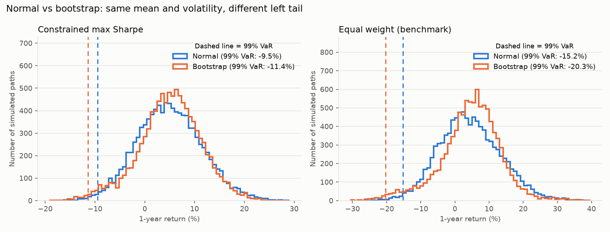
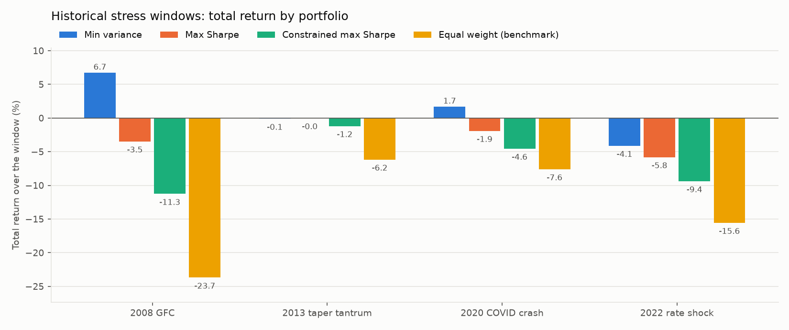

# Stage 1b results: Monte Carlo, stress tests, regimes

Generated by `python -m engine.run_stage1b`. Percent unless stated. Window 2007-06 to 2026-09 (232 months). Expected returns: Bayes-Stein. Covariance: Ledoit-Wolf on correlations. Portfolio weights are from Stage 1, estimated on the FULL sample, so every result below is in-sample (see DECISIONS.md honest limits).

## Portfolios

|     |   Min variance |   Max Sharpe |   Constrained max Sharpe |   Equal weight (benchmark) |
|:----|---------------:|-------------:|-------------------------:|---------------------------:|
| SPY |            1.8 |         16.8 |                     30.9 |                        9.1 |
| EFA |            0   |          0   |                      0   |                        9.1 |
| EEM |            0   |          0   |                      0   |                        9.1 |
| SHY |           98.1 |         74.4 |                     35   |                        9.1 |
| IEF |            0   |          0   |                     16.6 |                        9.1 |
| TLT |            0   |          0   |                      0   |                        9.1 |
| LQD |            0   |          0   |                      0   |                        9.1 |
| HYG |            0.1 |          0   |                      0   |                        9.1 |
| TIP |            0   |          0   |                      0   |                        9.1 |
| VNQ |            0   |          0   |                      0   |                        9.1 |
| GLD |            0   |          8.9 |                     17.6 |                        9.1 |

## Monte Carlo

10,000 paths, 60 months, seed 20261019, monthly rebalancing. Bootstrap: circular blocks of 6 months, mean-adjusted to the Bayes-Stein returns. Student-t: 5 degrees of freedom. VaR and CVaR are losses (positive = loss; negative means even that bad case is a gain). Target for 'miss target': 4% a year, illustrative.

### Risk metrics, 1y horizon

|                                           |   VaR_95 |   CVaR_95 |   VaR_99 |   CVaR_99 |   prob_loss |   prob_miss_target |   median_max_drawdown |   p95_max_drawdown |   p99_max_drawdown |
|:------------------------------------------|---------:|----------:|---------:|----------:|------------:|-------------------:|----------------------:|-------------------:|-------------------:|
| ('Min variance', 'normal')                |      0.6 |       1.2 |      1.6 |       2.2 |        10.8 |               91.8 |                   0.7 |                1.8 |                2.4 |
| ('Min variance', 'student_t')             |      0.6 |       1.3 |      1.7 |       2.4 |        10.4 |               92.1 |                   0.6 |                1.9 |                2.8 |
| ('Min variance', 'bootstrap')             |      1.4 |       2.4 |      3   |       3.6 |        11.9 |               86.7 |                   0.5 |                2.6 |                3.5 |
| ('Max Sharpe', 'normal')                  |      2.3 |       3.7 |      4.7 |       5.8 |        16.9 |               57.7 |                   1.8 |                4.4 |                5.9 |
| ('Max Sharpe', 'student_t')               |      2.2 |       3.9 |      4.8 |       6.5 |        16.1 |               58.3 |                   1.6 |                4.5 |                6.8 |
| ('Max Sharpe', 'bootstrap')               |      2.9 |       4.7 |      5.8 |       7   |        15.3 |               56   |                   1.6 |                5.3 |                7   |
| ('Constrained max Sharpe', 'normal')      |      5.4 |       7.9 |      9.5 |      11.5 |        22.6 |               44.9 |                   3.6 |                8.6 |               11.6 |
| ('Constrained max Sharpe', 'student_t')   |      5.2 |       8.2 |      9.8 |      12.7 |        21.7 |               45   |                   3.3 |                8.8 |               12.7 |
| ('Constrained max Sharpe', 'bootstrap')   |      6.4 |       9.5 |     11.4 |      13.7 |        18.7 |               41.5 |                   3.2 |               10.8 |               13.8 |
| ('Equal weight (benchmark)', 'normal')    |      9.5 |      13   |     15.2 |      18   |        32.2 |               50.3 |                   5.6 |               13.2 |               17.4 |
| ('Equal weight (benchmark)', 'student_t') |      9.6 |      13.4 |     15.1 |      19.4 |        31.8 |               50.2 |                   5.2 |               13.3 |               18.4 |
| ('Equal weight (benchmark)', 'bootstrap') |     11.9 |      17.2 |     20.3 |      23.6 |        25.5 |               43.9 |                   4.7 |               17.4 |               22.9 |

### Risk metrics, 5y horizon

|                                           |   VaR_95 |   CVaR_95 |   VaR_99 |   CVaR_99 |   prob_loss |   prob_miss_target |   median_max_drawdown |   p95_max_drawdown |   p99_max_drawdown |
|:------------------------------------------|---------:|----------:|---------:|----------:|------------:|-------------------:|----------------------:|-------------------:|-------------------:|
| ('Min variance', 'normal')                |     -3.8 |      -2.3 |     -1.3 |      -0.2 |         0.3 |               99.9 |                   1.5 |                2.8 |                3.8 |
| ('Min variance', 'student_t')             |     -3.8 |      -2.4 |     -1.5 |      -0.3 |         0.3 |               99.9 |                   1.4 |                3   |                4.1 |
| ('Min variance', 'bootstrap')             |     -2   |      -0.3 |      0.7 |       2.5 |         1.6 |               99   |                   1.2 |                4   |                5.8 |
| ('Max Sharpe', 'normal')                  |     -3.8 |      -0.8 |      0.9 |       3.3 |         1.4 |               66.8 |                   3.8 |                7.5 |                9.7 |
| ('Max Sharpe', 'student_t')               |     -3.9 |      -0.7 |      1.3 |       3.9 |         1.6 |               66.7 |                   3.7 |                7.7 |               10.5 |
| ('Max Sharpe', 'bootstrap')               |     -3.2 |       0.5 |      2.7 |       5.8 |         2.2 |               65.6 |                   4.3 |                8.6 |               11.4 |
| ('Constrained max Sharpe', 'normal')      |     -0.5 |       4.6 |      7.6 |      11.8 |         4.7 |               39.6 |                   7.7 |               15   |               19.4 |
| ('Constrained max Sharpe', 'student_t')   |     -0.3 |       5   |      8.3 |      12.6 |         4.8 |               39   |                   7.5 |               15.3 |               20.5 |
| ('Constrained max Sharpe', 'bootstrap')   |     -0.2 |       6.2 |      9.5 |      15.3 |         4.9 |               37.4 |                   7.5 |               16.9 |               22.7 |
| ('Equal weight (benchmark)', 'normal')    |     11.2 |      18   |     22.1 |      27.1 |        15.1 |               49.4 |                  12.6 |               24.4 |               30.6 |
| ('Equal weight (benchmark)', 'student_t') |     11.4 |      18.4 |     23.1 |      28.9 |        14.7 |               48.9 |                  12.1 |               24.7 |               31.9 |
| ('Equal weight (benchmark)', 'bootstrap') |     13.2 |      21.8 |     27.2 |      34.4 |        15.1 |               46.7 |                  11.7 |               28.9 |               37.8 |

### Terminal wealth after 5 years (starting at 1.00)

|                                           |   p01_terminal_surplus |   p05_terminal_surplus |   median_terminal_surplus |   p95_terminal_surplus |   mean_terminal_surplus |
|:------------------------------------------|-----------------------:|-----------------------:|--------------------------:|-----------------------:|------------------------:|
| ('Min variance', 'normal')                |                  1.013 |                  1.038 |                     1.096 |                  1.158 |                   1.097 |
| ('Min variance', 'student_t')             |                  1.015 |                  1.038 |                     1.096 |                  1.157 |                   1.097 |
| ('Min variance', 'bootstrap')             |                  0.993 |                  1.02  |                     1.095 |                  1.179 |                   1.097 |
| ('Max Sharpe', 'normal')                  |                  0.991 |                  1.038 |                     1.176 |                  1.336 |                   1.18  |
| ('Max Sharpe', 'student_t')               |                  0.987 |                  1.039 |                     1.178 |                  1.334 |                   1.181 |
| ('Max Sharpe', 'bootstrap')               |                  0.973 |                  1.032 |                     1.18  |                  1.332 |                   1.181 |
| ('Constrained max Sharpe', 'normal')      |                  0.924 |                  1.005 |                     1.263 |                  1.593 |                   1.277 |
| ('Constrained max Sharpe', 'student_t')   |                  0.917 |                  1.003 |                     1.265 |                  1.595 |                   1.277 |
| ('Constrained max Sharpe', 'bootstrap')   |                  0.905 |                  1.002 |                     1.271 |                  1.565 |                   1.277 |
| ('Equal weight (benchmark)', 'normal')    |                  0.779 |                  0.888 |                     1.22  |                  1.677 |                   1.244 |
| ('Equal weight (benchmark)', 'student_t') |                  0.769 |                  0.886 |                     1.223 |                  1.675 |                   1.245 |
| ('Equal weight (benchmark)', 'bootstrap') |                  0.728 |                  0.868 |                     1.236 |                  1.643 |                   1.244 |

### How much does the normal model understate tail risk? (1-year horizon)

| portfolio                |   CVaR99 normal |   CVaR99 student_t |   CVaR99 bootstrap |   normal understates CVaR99 by |   VaR99 normal |   VaR99 bootstrap |   normal understates VaR99 by |   worst actual 12m return |   monthly skew |   monthly excess kurtosis |
|:-------------------------|----------------:|-------------------:|-------------------:|-------------------------------:|---------------:|------------------:|------------------------------:|--------------------------:|---------------:|--------------------------:|
| Min variance             |             2.2 |                2.4 |                3.6 |                           38.2 |            1.6 |               3   |                          45.4 |                      -5.3 |           0.19 |                      2.15 |
| Max Sharpe               |             5.8 |                6.5 |                7   |                           18   |            4.7 |               5.8 |                          19   |                      -6.7 |          -0.38 |                      0.82 |
| Constrained max Sharpe   |            11.5 |               12.7 |               13.7 |                           16.5 |            9.5 |              11.4 |                          16.5 |                     -13.5 |          -0.52 |                      1.45 |
| Equal weight (benchmark) |            18   |               19.4 |               23.6 |                           23.7 |           15.2 |              20.3 |                          25.1 |                     -22.5 |          -0.54 |                      2.86 |

### Bootstrap block-length sensitivity (constrained max Sharpe, 1-year VaR/CVaR)

|   block_months |   VaR_99 |   CVaR_99 |   p99_max_drawdown_5y |
|---------------:|---------:|----------:|----------------------:|
|              1 |    10.17 |     12.26 |                 21.37 |
|              3 |     9.43 |     12.57 |                 19.98 |
|              6 |    11.39 |     13.73 |                 22.73 |
|             12 |    11.65 |     12.54 |                 23.46 |

## Historical stress windows

Daily marks, monthly rebalancing. `max_drawdown_monthly` uses month ends only, to show what monthly data hides.

- **2008 GFC** (2007-11 to 2009-02): US equity peak (Oct 2007 month end) to the last month end before the March 2009 low. Credit and liquidity crisis; correlations jumped, Treasuries rallied.
- **2013 taper tantrum** (2013-05 to 2013-08): Fed signals slower bond buying (22 May 2013); 10y yield rose from about 1.6% to about 2.8%. Pure rate shock with equities roughly flat.
- **2020 COVID crash** (2020-02 to 2020-03): Fastest bear market on record (19 Feb to 23 Mar 2020); credit spreads blew out, then policy response.
- **2022 rate shock** (2022-01 to 2022-12): Calendar 2022: fastest Fed hiking cycle in decades; stocks and bonds fell together.

|                                                    |   total_return |   max_drawdown_daily |   max_drawdown_monthly |
|:---------------------------------------------------|---------------:|---------------------:|-----------------------:|
| ('2008 GFC', 'Min variance')                       |            6.7 |                  2.1 |                    1   |
| ('2008 GFC', 'Max Sharpe')                         |           -3.5 |                  8.2 |                    6.4 |
| ('2008 GFC', 'Constrained max Sharpe')             |          -11.3 |                 17.2 |                   13.5 |
| ('2008 GFC', 'Equal weight (benchmark)')           |          -23.7 |                 28.5 |                   23.9 |
| ('2013 taper tantrum', 'Min variance')             |           -0.1 |                  0.4 |                    0.2 |
| ('2013 taper tantrum', 'Max Sharpe')               |           -0   |                  2   |                    1.5 |
| ('2013 taper tantrum', 'Constrained max Sharpe')   |           -1.2 |                  4.5 |                    3.7 |
| ('2013 taper tantrum', 'Equal weight (benchmark)') |           -6.2 |                  8.7 |                    6.7 |
| ('2020 COVID crash', 'Min variance')               |            1.7 |                  0.9 |                    0   |
| ('2020 COVID crash', 'Max Sharpe')                 |           -1.9 |                  5.1 |                    1.9 |
| ('2020 COVID crash', 'Constrained max Sharpe')     |           -4.6 |                 10.5 |                    4.6 |
| ('2020 COVID crash', 'Equal weight (benchmark)')   |           -7.6 |                 16.4 |                    7.6 |
| ('2022 rate shock', 'Min variance')                |           -4.1 |                  5.3 |                    4.9 |
| ('2022 rate shock', 'Max Sharpe')                  |           -5.8 |                  8.6 |                    8.3 |
| ('2022 rate shock', 'Constrained max Sharpe')      |           -9.4 |                 13.7 |                   13.3 |
| ('2022 rate shock', 'Equal weight (benchmark)')    |          -15.6 |                 21   |                   20   |

### Asset returns in each window

|                    |   SPY |   EFA |   EEM |   SHY |   IEF |   TLT |   LQD |   HYG |   TIP |   VNQ |   GLD |
|:-------------------|------:|------:|------:|------:|------:|------:|------:|------:|------:|------:|------:|
| 2008 GFC           | -50.8 | -57.4 | -60.4 |   8.2 |  17.1 |  20   |  -4.5 | -27.2 |   1.9 | -64.6 |  17.8 |
| 2013 taper tantrum |   3   |  -2.5 | -11   |  -0.2 |  -7.2 | -13   |  -6.3 |  -2.7 |  -8.7 | -13.5 |  -5.7 |
| 2020 COVID crash   | -19.4 | -20.8 | -19   |   2.1 |   6.8 |  13.4 |  -5.3 | -11.2 |  -0.9 | -25.1 |  -0.9 |
| 2022 rate shock    | -18.2 | -14.4 | -20.6 |  -3.9 | -15.2 | -31.2 | -17.9 | -11   | -12.3 | -26.3 |  -0.8 |

## Hypothetical shocks (simple factor shocks, NOT duration-based)

Instant moves, no rebalancing, unlisted assets unchanged. Assumptions are in `src/engine/stress.py` and DECISIONS.md D-025. Stage 2 replaces rate and spread shocks with duration-based bond math.

Shock per asset:

|     |   Equity -30% |   Credit spreads wider |   Rates up |   All three at once |
|:----|--------------:|-----------------------:|-----------:|--------------------:|
| SPY |           -30 |                      0 |          0 |                 -30 |
| EFA |           -30 |                      0 |          0 |                 -30 |
| EEM |           -35 |                      0 |          0 |                 -35 |
| VNQ |           -30 |                      0 |          0 |                 -30 |
| HYG |             0 |                    -12 |          0 |                 -12 |
| LQD |             0 |                    -10 |         -7 |                 -17 |
| SHY |             0 |                      0 |         -2 |                  -2 |
| IEF |             0 |                      0 |         -7 |                  -7 |
| TLT |             0 |                      0 |        -15 |                 -15 |
| TIP |             0 |                      0 |         -6 |                  -6 |

Portfolio impact:

|                      |   Min variance |   Max Sharpe |   Constrained max Sharpe |   Equal weight (benchmark) |
|:---------------------|---------------:|-------------:|-------------------------:|---------------------------:|
| Equity -30%          |          -0.54 |        -5.03 |                    -9.26 |                     -11.36 |
| Credit spreads wider |          -0.02 |        -0    |                    -0    |                      -2    |
| Rates up             |          -1.96 |        -1.49 |                    -1.86 |                      -3.36 |
| All three at once    |          -2.51 |        -6.51 |                   -11.12 |                     -16.73 |

## Rules-based regimes

- Rates: rising if the 10y Treasury yield is above its level 12 months earlier.
- Volatility: high if SPY's trailing 63-day realized volatility (annualized) is above 20%.
- Each month is labeled with data up to the end of the PREVIOUS month (no look-ahead).

Months in each combination:

| rates   |   high |   low |
|:--------|-------:|------:|
| falling |     39 |    90 |
| rising  |     13 |    90 |

Checks: 2022 rate labels = {'rising': 12}; 2008 volatility labels = {'high': 8, 'low': 4}; Sep 2008 to Jun 2009 all high = True.

### Rates regime

| regime   |   months |   avg_correlation |
|:---------|---------:|------------------:|
| falling  |      129 |             0.313 |
| rising   |      103 |             0.523 |

Asset annualized mean and volatility:

|     |   ('falling', 'mean') |   ('falling', 'vol') |   ('rising', 'mean') |   ('rising', 'vol') |
|:----|----------------------:|---------------------:|---------------------:|--------------------:|
| SPY |                  10.5 |                 16.6 |                 12.5 |                14   |
| EFA |                   5.1 |                 19.5 |                  6.8 |                14.4 |
| EEM |                   8.1 |                 24.3 |                  4.9 |                16.2 |
| SHY |                   2.3 |                  1.4 |                  1.2 |                 1.6 |
| IEF |                   4.7 |                  6.7 |                  1.3 |                 6.7 |
| TLT |                   5.5 |                 15.3 |                  1.1 |                12.6 |
| LQD |                   5.8 |                  8.5 |                  2   |                 7.9 |
| HYG |                   6   |                 12.2 |                  4.1 |                 7   |
| TIP |                   4.6 |                  6   |                  1.8 |                 5.6 |
| VNQ |                   4.6 |                 25.5 |                 10.9 |                17.3 |
| GLD |                  10.9 |                 19.2 |                 10.4 |                15.5 |

Portfolio performance:

|                                         |   ann_return |   ann_vol |   worst_month |   pct_months_negative |   sharpe |
|:----------------------------------------|-------------:|----------:|--------------:|----------------------:|---------:|
| ('falling', 'Min variance')             |          2.4 |       1.3 |          -0.7 |                  28.7 |     1.06 |
| ('falling', 'Max Sharpe')               |          4.4 |       3.4 |          -3.4 |                  34.9 |     0.99 |
| ('falling', 'Constrained max Sharpe')   |          6.7 |       6.4 |          -7.7 |                  34.1 |     0.89 |
| ('falling', 'Equal weight (benchmark)') |          6.2 |       9.5 |         -12.2 |                  41.1 |     0.54 |
| ('rising', 'Min variance')              |          1.4 |       1.7 |          -1.3 |                  34   |    -0.23 |
| ('rising', 'Max Sharpe')                |          3.9 |       3.5 |          -2.7 |                  36.9 |     0.61 |
| ('rising', 'Constrained max Sharpe')    |          6.3 |       6.2 |          -4.6 |                  38.8 |     0.73 |
| ('rising', 'Equal weight (benchmark)')  |          5.2 |       8   |          -6.9 |                  36.9 |     0.42 |

### Volatility regime

| regime   |   months |   avg_correlation |
|:---------|---------:|------------------:|
| high     |       52 |             0.44  |
| low      |      180 |             0.347 |

Asset annualized mean and volatility:

|     |   ('high', 'mean') |   ('high', 'vol') |   ('low', 'mean') |   ('low', 'vol') |
|:----|-------------------:|------------------:|------------------:|-----------------:|
| SPY |               14.8 |              23.2 |              10.4 |             12.5 |
| EFA |               12.6 |              26.1 |               3.9 |             13.9 |
| EEM |               18.2 |              31.6 |               3.3 |             16.8 |
| SHY |                1.1 |               1.7 |               2   |              1.5 |
| IEF |                2.1 |               8.3 |               3.5 |              6.2 |
| TLT |                2.1 |              18.6 |               4   |             12.6 |
| LQD |                8.2 |              13.2 |               2.9 |              6.2 |
| HYG |                9.5 |              18.2 |               3.9 |              6.3 |
| TIP |                3.4 |               8.6 |               3.4 |              4.7 |
| VNQ |                5.2 |              35.7 |               8.1 |             16.6 |
| GLD |               10.4 |              20   |              10.8 |             17   |

Portfolio performance:

|                                      |   ann_return |   ann_vol |   worst_month |   pct_months_negative |   sharpe |
|:-------------------------------------|-------------:|----------:|--------------:|----------------------:|---------:|
| ('high', 'Min variance')             |          1.4 |       1.7 |          -1.3 |                  28.8 |     0.19 |
| ('high', 'Max Sharpe')               |          4.2 |       5   |          -3.4 |                  34.6 |     0.64 |
| ('high', 'Constrained max Sharpe')   |          7.1 |       9.3 |          -7.7 |                  32.7 |     0.66 |
| ('high', 'Equal weight (benchmark)') |          8   |      14.1 |         -12.2 |                  36.5 |     0.49 |
| ('low', 'Min variance')              |          2.2 |       1.4 |          -1.3 |                  31.7 |     0.47 |
| ('low', 'Max Sharpe')                |          4.2 |       2.9 |          -2.2 |                  36.1 |     0.95 |
| ('low', 'Constrained max Sharpe')    |          6.4 |       5.2 |          -4   |                  37.2 |     0.95 |
| ('low', 'Equal weight (benchmark)')  |          5.1 |       6.7 |          -6.2 |                  40   |     0.54 |

### Full sample, for comparison

| portfolio                |   ann_return |   ann_vol |   sharpe |
|:-------------------------|-------------:|----------:|---------:|
| Min variance             |          2   |       1.5 |     0.4  |
| Max Sharpe               |          4.2 |       3.4 |     0.82 |
| Constrained max Sharpe   |          6.6 |       6.3 |     0.82 |
| Equal weight (benchmark) |          5.7 |       8.9 |     0.49 |
