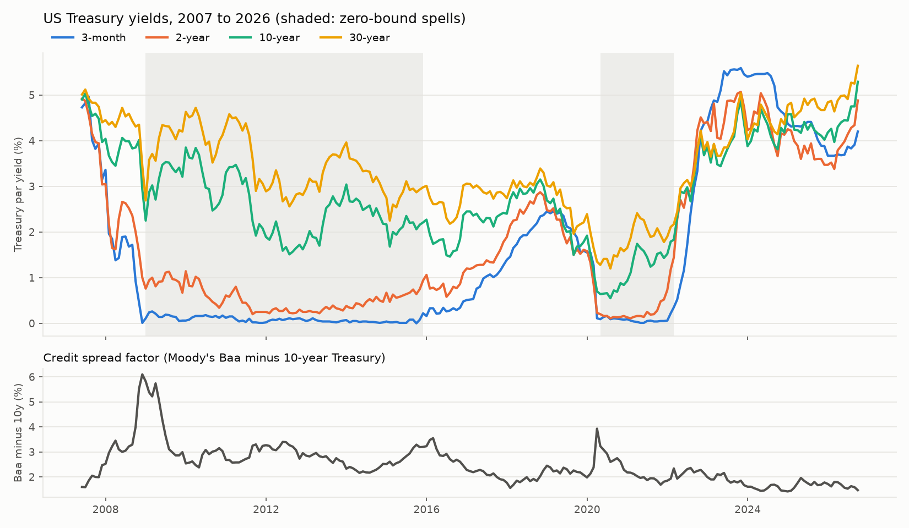
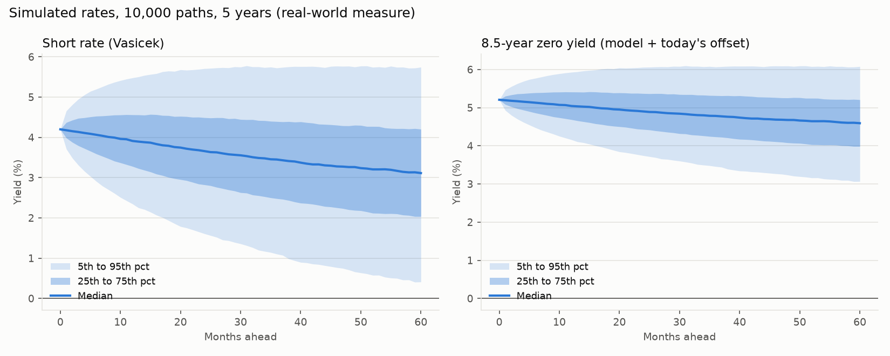
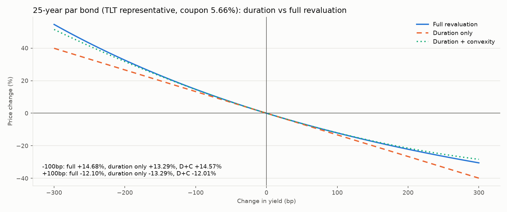

# Stage 2 results: fixed income, stochastic rates, yield-based expected returns

Generated by `python -m engine.run_stage2`. Data: FRED Treasury par yields and Moody's Baa-10y spread, month ends 2007-05 to 2026-09. ICE OAS used only for today's level. Percent unless stated.

## Today's curve (2026-09-30)

|       |   par |   zero (semiannual) |   zero (continuous) |
|------:|------:|--------------------:|--------------------:|
|  0.25 |  4.2  |               4.2   |               4.157 |
|  1    |  4.54 |               4.543 |               4.492 |
|  2    |  4.88 |               4.891 |               4.832 |
|  5    |  5.09 |               5.109 |               5.045 |
|  7    |  5.19 |               5.219 |               5.152 |
| 10    |  5.29 |               5.333 |               5.263 |
| 20    |  5.68 |               5.888 |               5.803 |
| 30    |  5.64 |               5.735 |               5.654 |

ICE OAS today: IG 0.84%, HY 3.12%. Baa-10y today: 1.47%.

## Bond math validation (par bonds on today's curve)

Errors are (estimate minus full revaluation) for a 100bp yield move, in percentage points of price.

|   maturity |   coupon |   price_off_curve |   macaulay |   modified |   fd_duration |   convexity |   second_diff_convexity |    dv01 |   effective_duration |   sum_krd |   err_D_+1% |   err_DC_+1% |   err_D_-1% |   err_DC_-1% |   zero_price_curve |   zero_price_closed_form |
|-----------:|---------:|------------------:|-----------:|-----------:|--------------:|------------:|------------------------:|--------:|---------------------:|----------:|------------:|-------------:|------------:|-------------:|-------------------:|-------------------------:|
|          2 |   0.0488 |               100 |    1.92967 |    1.88371 |       1.88371 |      4.5417 |                  4.5417 | 0.01884 |              1.88766 |   1.88766 |    -0.02249 |      0.00022 |    -0.02293 |     -0.00022 |            90.7882 |                  90.7882 |
|          5 |   0.0509 |               100 |    4.47699 |    4.36587 |       4.36587 |     22.5346 |                 22.5346 | 0.04366 |              4.38016 |   4.38016 |    -0.11055 |      0.00212 |    -0.11486 |     -0.00219 |            77.705  |                  77.705  |
|         10 |   0.0529 |               100 |    7.89224 |    7.68887 |       7.68888 |     72.18   |                 72.18   | 0.07689 |              7.73596 |   7.73596 |    -0.34889 |      0.01201 |    -0.37359 |     -0.01269 |            59.0768 |                  59.0768 |
|         30 |   0.0564 |               100 |   14.7938  |   14.388   |      14.3881  |    315.168  |                315.168  | 0.14388 |             14.4794  |  14.4794  |    -1.44992 |      0.12592 |    -1.72053 |     -0.14469 |            18.3363 |                  18.3363 |

## Vasicek calibration (3-month yield as the short rate, monthly AR(1), exact form)

| sample                                  |   n_pairs |      a |   a_se |   half_life_years |      b |   b_se |   sigma |   sigma_se |
|:----------------------------------------|----------:|-------:|-------:|------------------:|-------:|-------:|--------:|-----------:|
| full 2007-2026                          |       232 | 0.1027 | 0.0914 |            6.747  | 0.0127 | 0.0167 |  0.0075 |     0.0003 |
| excluding 2008-12 to 2015-11            |       147 | 0.1389 | 0.1423 |            4.9919 | 0.0197 | 0.0196 |  0.0093 |     0.0005 |
| excluding both zero-bound spells (USED) |       123 | 0.1503 | 0.184  |            4.6114 | 0.0211 | 0.0229 |  0.0102 |     0.0006 |
| post 2015-12 only                       |       129 | 0.0812 | 0.1107 |            8.5358 | 0.0698 | 0.0683 |  0.007  |     0.0004 |

Months with the 3M yield below 0.25%: 110 of 233.

Used: a = 0.1503, b = 0.0211, sigma = 0.0102, market price of risk lam = 0.3370 (fitted so the model's average 10y zero yield equals the actual average), pricing level b_q = 0.0439. Starting short rate r0 = 0.0420.

Model curve today vs actual (continuous zero yields). Vasicek does NOT fit today's curve; the simulation adds a constant per-maturity offset so it starts on the actual curve:

|       |   model |   actual |   offset |
|------:|--------:|---------:|---------:|
|  0.25 |   4.203 |    4.157 |   -0.047 |
|  2    |   4.22  |    4.832 |    0.612 |
|  5    |   4.231 |    5.045 |    0.814 |
| 10    |   4.227 |    5.263 |    1.037 |
| 20    |   4.207 |    5.803 |    1.596 |
| 30    |   4.194 |    5.654 |    1.461 |

## Simulation checks (100,000 paths, pricing measure)

|   horizon_years |   MC E[exp(-int r)] |   closed form P(0,T) |   MC std error |   sim mean r |   analytic mean r |   sim var r |   analytic var r |
|----------------:|--------------------:|---------------------:|---------------:|-------------:|------------------:|------------:|-----------------:|
|               1 |            0.958734 |             0.958755 |       0.000017 |     0.042320 |          0.042264 |    0.000089 |         0.000090 |
|               5 |            0.809257 |             0.809341 |       0.000129 |     0.042997 |          0.043000 |    0.000268 |         0.000268 |
|              10 |            0.655196 |             0.655290 |       0.000236 |     0.043509 |          0.043472 |    0.000329 |         0.000328 |

## Credit spread and correlation model

Log-OU on Baa-10y: kappa = 0.461 (se 0.230), long-run median spread 2.36%, sigma (of log spread) = 0.280. Shock correlations (standardized residuals, all months):

|        |   rate |   spread |   equity |
|:-------|-------:|---------:|---------:|
| rate   |  1     |   -0.382 |    0.184 |
| spread | -0.382 |    1     |   -0.582 |
| equity |  0.184 |   -0.582 |    1     |

Simulated shock correlations: rate-spread -0.380, rate-equity 0.182, spread-equity -0.580. Minimum simulated spread: 0.568%. Share of paths with a negative short rate at 5 years: 3.1%.

## Empirical durations (monthly ETF return on yield change at representative maturity)

`published_approx` are rough fact-sheet figures quoted from memory, NOT fetched.

| etf   | model              |   duration |   duration_se |   spread_beta |   spread_beta_se |    r2 |   published_approx |
|:------|:-------------------|-----------:|--------------:|--------------:|-----------------:|------:|-------------------:|
| SHY   | rates only         |      1.799 |         0.035 |       nan     |          nan     | 0.919 |                1.9 |
| IEF   | rates only         |      7.528 |         0.059 |       nan     |          nan     | 0.986 |                7.1 |
| TLT   | rates only         |     16.956 |         0.148 |       nan     |          nan     | 0.983 |               16.3 |
| TIP   | rates only         |      4.446 |         0.31  |       nan     |          nan     | 0.473 |                6.6 |
| LQD   | rates only         |      6.049 |         0.484 |       nan     |          nan     | 0.405 |                8.2 |
| LQD   | rates + Baa spread |      8.337 |         0.356 |         6.079 |            0.369 | 0.728 |                8.2 |
| HYG   | rates only         |      0.431 |         0.792 |       nan     |          nan     | 0.001 |                3   |
| HYG   | rates + Baa spread |      5.15  |         0.66  |         9.675 |            0.669 | 0.478 |                3   |

Representative bonds used for the mapping and stress tests:

| etf   |   maturity |   coupon |    ytm |   par_duration |   rate_beta |   duration_used |   convexity_used | source                                  |
|:------|-----------:|---------:|-------:|---------------:|------------:|----------------:|-----------------:|:----------------------------------------|
| SHY   |        2   |   0.0488 | 0.0488 |         1.8837 |      0.9549 |          1.7987 |           4.1409 | empirical (R2 0.92)                     |
| IEF   |        8.5 |   0.0524 | 0.0524 |         6.7891 |      1.1089 |          7.5284 |          68.183  | empirical (R2 0.99)                     |
| TLT   |       25   |   0.0566 | 0.0566 |        13.2907 |      1.2757 |         16.9555 |         417.951  | empirical (R2 0.98)                     |
| TIP   |        7.5 |   0.0521 | 0.0521 |         6.1439 |      0.7237 |          4.4462 |          23.587  | empirical (R2 0.47)                     |
| LQD   |       12   |   0.0621 | 0.0622 |         8.3708 |      1      |          8.3708 |          89.6843 | bond math (rates-only R2 0.40 too weak) |
| HYG   |        4   |   0.0814 | 0.0823 |         3.3542 |      1      |          3.3542 |          13.8225 | bond math (rates-only R2 0.00 too weak) |

Spread betas to the Baa factor: LQD 6.08, HYG 9.68.

## Factor model vs historical bootstrap (monthly simulated returns, 10,000 paths)

Bootstrap means are Bayes-Stein (Stage 1b); factor-model bond means come from yields plus the simulated rate path. BIL in the factor model earns the short rate; it is not in this table.

| asset   |   factor mean |   bootstrap mean |   factor vol |   bootstrap vol |   historical vol |   factor 1y 5th pct |   bootstrap 1y 5th pct |   factor corr with SPY |   historical corr with SPY |
|:--------|--------------:|-----------------:|-------------:|----------------:|-----------------:|--------------------:|-----------------------:|-----------------------:|---------------------------:|
| SPY     |           8.2 |              8.2 |         15.5 |            15.4 |             15.5 |               -16.7 |                  -22   |                  1     |                      1     |
| EFA     |           4.5 |              4.4 |         17.4 |            17.3 |             17.4 |               -22.3 |                  -26.6 |                  0.866 |                      0.866 |
| EEM     |           5   |              5   |         21   |            21   |             21   |               -27.1 |                  -31.2 |                  0.753 |                      0.754 |
| SHY     |           4.7 |              1.7 |          1.6 |             1.5 |              1.5 |                 3.4 |                   -1.5 |                 -0.175 |                     -0.101 |
| IEF     |           5.9 |              2.7 |          4.3 |             6.7 |              6.7 |                 0.1 |                   -8.4 |                 -0.18  |                     -0.063 |
| TLT     |           6.7 |              3   |          4.5 |            14.1 |             14.1 |                 0.3 |                  -19.3 |                 -0.181 |                     -0.078 |
| LQD     |           5.9 |              3.3 |          4.3 |             8.2 |              8.3 |                -0.3 |                  -10.2 |                  0.298 |                      0.454 |
| HYG     |           5.2 |              3.9 |          5.4 |            10.1 |             10.2 |                -2.6 |                  -12.3 |                  0.499 |                      0.735 |
| TIP     |           5.4 |              2.8 |          2.7 |             5.8 |              5.8 |                 2.1 |                   -7.2 |                 -0.18  |                      0.343 |
| VNQ     |           5.5 |              5.6 |         22.2 |            22.1 |             22.3 |               -28.4 |                  -29.7 |                  0.74  |                      0.743 |
| GLD     |           7.7 |              7.6 |         17.8 |            17.6 |             17.6 |               -21   |                  -19.1 |                  0.078 |                      0.086 |

## Yield-based expected returns

Bond ETFs: par yield at the representative maturity (credit: plus today's ICE OAS minus expected loss IG 0.20%, HY 2.50%). Equities, REITs, gold keep Bayes-Stein. Risk-free: historical BIL mean 1.38% before, today's 3M yield 4.20% after.

|     |   Bayes-Stein (history) |   yield-based (Stage 2) | changed   |
|:----|------------------------:|------------------------:|:----------|
| SPY |                    8.1  |                    8.1  | False     |
| EFA |                    4.41 |                    4.41 | False     |
| EEM |                    4.97 |                    4.97 | False     |
| SHY |                    1.73 |                    4.88 | True      |
| IEF |                    2.67 |                    5.24 | True      |
| TLT |                    2.9  |                    5.66 | True      |
| LQD |                    3.25 |                    6.01 | True      |
| HYG |                    3.94 |                    5.64 | True      |
| TIP |                    2.78 |                    5.21 | True      |
| VNQ |                    5.47 |                    5.47 | False     |
| GLD |                    7.63 |                    7.63 | False     |

Treasuries vs cash:

|     |   excess over cash before |   excess over cash after |
|:----|--------------------------:|-------------------------:|
| SHY |                      0.35 |                     0.68 |
| IEF |                      1.28 |                     1.04 |
| TLT |                      1.51 |                     1.46 |

### Optimized weights before vs after

|     |   Min variance (before) |   Max Sharpe (before) |   Constrained max Sharpe (before) |   Min variance (after) |   Max Sharpe (after) |   Constrained max Sharpe (after) |
|:----|------------------------:|----------------------:|----------------------------------:|-----------------------:|---------------------:|---------------------------------:|
| SPY |                     1.8 |                  16.8 |                              30.9 |                    1.8 |                  5.8 |                             25   |
| EFA |                     0   |                   0   |                               0   |                    0   |                  0   |                              0   |
| EEM |                     0   |                   0   |                               0   |                    0   |                  0   |                              0   |
| SHY |                    98.1 |                  74.4 |                              35   |                   98.1 |                 93.8 |                             35   |
| IEF |                     0   |                   0   |                              16.6 |                    0   |                  0   |                             29.4 |
| TLT |                     0   |                   0   |                               0   |                    0   |                  0   |                              0   |
| LQD |                     0   |                   0   |                               0   |                    0   |                  0   |                              0   |
| HYG |                     0.1 |                   0   |                               0   |                    0.1 |                  0   |                              0   |
| TIP |                     0   |                   0   |                               0   |                    0   |                  0   |                              0   |
| VNQ |                     0   |                   0   |                               0   |                    0   |                  0   |                              0   |
| GLD |                     0   |                   8.9 |                              17.6 |                    0   |                  0.4 |                             10.6 |

|                                      |   exp_return |   volatility |   sharpe |
|:-------------------------------------|-------------:|-------------:|---------:|
| ('before', 'Min variance')           |         1.85 |         1.49 |    0.311 |
| ('before', 'Max Sharpe')             |         3.32 |         3.42 |    0.567 |
| ('before', 'Constrained max Sharpe') |         4.89 |         6.28 |    0.558 |
| ('after', 'Min variance')            |         4.94 |         1.49 |    0.495 |
| ('after', 'Max Sharpe')              |         5.08 |         1.63 |    0.537 |
| ('after', 'Constrained max Sharpe')  |         6.08 |         5.21 |    0.361 |

Constrained efficient frontier, yield-based inputs:

|   expected_return |   volatility |   sharpe | success   |
|------------------:|-------------:|---------:|:----------|
|              5.18 |         3.87 |    0.253 | True      |
|              5.37 |         3.96 |    0.296 | True      |
|              5.57 |         4.17 |    0.327 | True      |
|              5.76 |         4.48 |    0.348 | True      |
|              5.95 |         4.88 |    0.359 | True      |
|              6.15 |         5.39 |    0.361 | True      |
|              6.34 |         6.01 |    0.356 | True      |
|              6.53 |         6.69 |    0.349 | True      |
|              6.73 |         7.43 |    0.34  | True      |
|              6.92 |         8.24 |    0.33  | True      |
|              7.11 |         9.09 |    0.321 | True      |
|              7.31 |         9.96 |    0.312 | True      |

## Duration-based stress tests (Stage 2)

Shocks to the Treasury par curve or credit OAS, applied through key rate durations and convexity of each ETF's representative bond (rate beta applied). `dy_bp` is the effective shock at the bond's maturity. Equities, REITs, gold and BIL are not shocked (0%).

|                              |    dy_bp |   duration_convexity |   full_revaluation |   approx_error |
|:-----------------------------|---------:|---------------------:|-------------------:|---------------:|
| ('Parallel +100bp', 'SHY')   |   95.486 |               -1.782 |             -1.782 |          0     |
| ('Parallel -100bp', 'SHY')   |  -95.486 |                1.823 |              1.823 |         -0     |
| ('Steepener', 'SHY')         |  -47.743 |                0.906 |              0.906 |         -0     |
| ('Flattener', 'SHY')         |   47.743 |               -0.896 |             -0.896 |          0     |
| ('Parallel +100bp', 'IEF')   |  110.89  |               -7.224 |             -7.235 |          0.011 |
| ('Parallel -100bp', 'IEF')   | -110.89  |                7.911 |              7.923 |         -0.012 |
| ('Steepener', 'IEF')         |  -10.396 |                0.712 |              0.718 |         -0.005 |
| ('Flattener', 'IEF')         |   10.396 |               -0.706 |             -0.701 |         -0.005 |
| ('Parallel +100bp', 'TLT')   |  127.575 |              -15.012 |            -15.201 |          0.189 |
| ('Parallel -100bp', 'TLT')   | -127.575 |               19.29  |             19.51  |         -0.22  |
| ('Steepener', 'TLT')         |   47.84  |               -6.131 |             -6.288 |          0.157 |
| ('Flattener', 'TLT')         |  -47.84  |                6.732 |              6.58  |          0.153 |
| ('Parallel +100bp', 'TIP')   |   72.368 |               -4.348 |             -4.351 |          0.002 |
| ('Parallel -100bp', 'TIP')   |  -72.368 |                4.586 |              4.588 |         -0.002 |
| ('Steepener', 'TIP')         |  -11.307 |                0.701 |              0.704 |         -0.003 |
| ('Flattener', 'TIP')         |   11.307 |               -0.695 |             -0.693 |         -0.003 |
| ('Parallel +100bp', 'LQD')   |  100     |               -8.011 |             -8.029 |          0.018 |
| ('Parallel -100bp', 'LQD')   | -100     |                8.927 |              8.946 |         -0.019 |
| ('Steepener', 'LQD')         |    5     |               -0.33  |             -0.333 |          0.003 |
| ('Flattener', 'LQD')         |   -5     |                0.333 |              0.33  |          0.003 |
| ('Parallel +100bp', 'HYG')   |  100     |               -3.343 |             -3.344 |          0.001 |
| ('Parallel -100bp', 'HYG')   | -100     |                3.486 |              3.487 |         -0.001 |
| ('Steepener', 'HYG')         |  -37.5   |                1.306 |              1.308 |         -0.002 |
| ('Flattener', 'HYG')         |   37.5   |               -1.286 |             -1.284 |         -0.002 |
| ('IG spreads +100bp', 'LQD') |  100     |               -7.922 |             -7.94  |          0.017 |
| ('HY spreads +400bp', 'HYG') |  400     |              -12.311 |            -12.377 |          0.066 |

Portfolio impact (full revaluation, %):

|                   |   Min variance (before) |   Max Sharpe (before) |   Constrained max Sharpe (before) |   Min variance (after) |   Max Sharpe (after) |   Constrained max Sharpe (after) |   Equal weight |
|:------------------|------------------------:|----------------------:|----------------------------------:|-----------------------:|---------------------:|---------------------------------:|---------------:|
| Parallel +100bp   |                   -1.75 |                 -1.32 |                             -1.82 |                  -1.75 |                -1.67 |                            -2.75 |          -3.63 |
| Parallel -100bp   |                    1.79 |                  1.36 |                              1.95 |                   1.79 |                 1.71 |                             2.97 |           4.21 |
| Steepener         |                    0.89 |                  0.67 |                              0.44 |                   0.89 |                 0.85 |                             0.53 |          -0.27 |
| Flattener         |                   -0.88 |                 -0.67 |                             -0.43 |                  -0.88 |                -0.84 |                            -0.52 |           0.3  |
| IG spreads +100bp |                    0    |                  0    |                             -0    |                   0    |                -0    |                             0    |          -0.72 |
| HY spreads +400bp |                   -0.02 |                 -0    |                             -0    |                  -0.02 |                -0    |                             0    |          -1.13 |

For comparison, the Stage 1b SIMPLE FACTOR SHOCKS (judgment-based, not duration-based), same portfolios:

|                      |   Min variance (before) |   Max Sharpe (before) |   Constrained max Sharpe (before) |   Min variance (after) |   Max Sharpe (after) |   Constrained max Sharpe (after) |   Equal weight |
|:---------------------|------------------------:|----------------------:|----------------------------------:|-----------------------:|---------------------:|---------------------------------:|---------------:|
| Equity -30%          |                   -0.54 |                 -5.03 |                             -9.26 |                  -0.54 |                -1.74 |                            -7.5  |         -11.36 |
| Credit spreads wider |                   -0.02 |                 -0    |                             -0    |                  -0.02 |                -0    |                             0    |          -2    |
| Rates up             |                   -1.96 |                 -1.49 |                             -1.86 |                  -1.96 |                -1.88 |                            -2.76 |          -3.36 |

