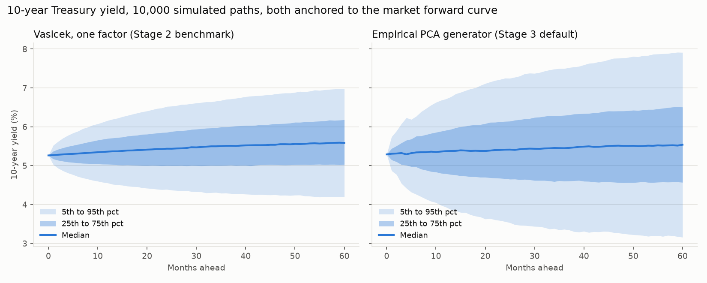
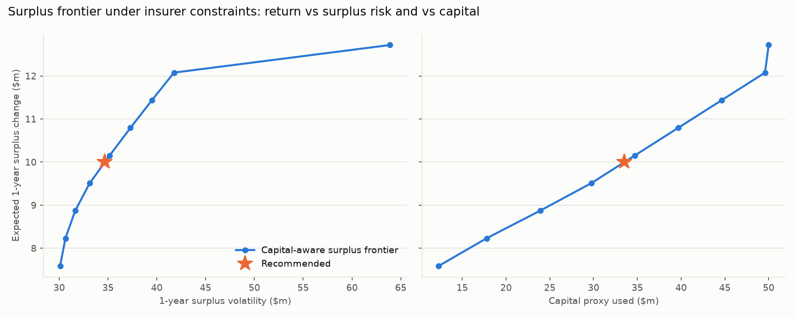

# Stage 3 results: liabilities, surplus, ALM, liquidity, capital-aware optimization

Generated by `python -m engine.run_stage3`. $ figures in millions. SYNTHETIC insurer. Capital figures are a PROXY, not NAIC RBC.

## 0. Fixing P-013: empirical PCA curve generator

Explained variance of monthly par-curve changes by principal component:

|           |   explained |   cumulative |
|:----------|------------:|-------------:|
| level     |      0.7842 |       0.7842 |
| slope     |      0.1496 |       0.9338 |
| curvature |      0.0477 |       0.9815 |
| PC4       |      0.0117 |       0.9932 |
| PC5       |      0.0041 |       0.9972 |

Loadings (first three components):

|       |   level |   slope |   curvature |
|------:|--------:|--------:|------------:|
|  0.25 |   0.168 |  -0.637 |       0.561 |
|  1    |   0.26  |  -0.496 |       0.021 |
|  2    |   0.341 |  -0.328 |      -0.432 |
|  5    |   0.419 |  -0.01  |      -0.388 |
|  7    |   0.426 |   0.105 |      -0.207 |
| 10    |   0.412 |   0.213 |       0.052 |
| 20    |   0.373 |   0.306 |       0.334 |
| 30    |   0.35  |   0.3   |       0.436 |

Annual volatility, historical vs both generators:

| etf   |   historical |   Vasicek factor model (Stage 2) |   PCA generator (Stage 3) |
|:------|-------------:|---------------------------------:|--------------------------:|
| SHY   |         1.52 |                             1.63 |                      1.47 |
| IEF   |         6.72 |                             4.33 |                      6.66 |
| TLT   |        14.13 |                             4.48 |                     13.99 |
| TIP   |         5.8  |                             2.73 |                      5.75 |
| LQD   |         8.26 |                             4.27 |                      8.2  |
| HYG   |        10.21 |                             5.4  |                     10.23 |

10-year yield change volatility: history 88bp/yr, PCA generator 87bp/yr, Vasicek 52bp/yr. TLT volatility: history 14.1%, Vasicek 4.5%, PCA 14.0%.

Anchor curves (par yields, %): the market 5-year forward curve is the default; history and today's curve are sensitivities.

|       |   today |   forward (5y ahead, DEFAULT) |   historical average |
|------:|--------:|------------------------------:|---------------------:|
|  0.25 |    4.2  |                          5.4  |                 1.54 |
|  1    |    4.54 |                          5.43 |                 1.67 |
|  2    |    4.88 |                          5.49 |                 1.78 |
|  5    |    5.09 |                          5.55 |                 2.25 |
|  7    |    5.19 |                          5.64 |                 2.55 |
| 10    |    5.29 |                          5.78 |                 2.82 |
| 20    |    5.68 |                          5.94 |                 3.32 |
| 30    |    5.64 |                          5.84 |                 3.44 |

Vasicek benchmark with the anchored level: b = 5.40% (historical estimate 2.11%), lam refit = -0.150.

## 1. Synthetic liabilities

Synthetic payout annuity block (illustrative): 30 annual payments falling 3% a year, first payment $93.3m. Discounted on the Treasury zero curve (same as assets).

|                             |         0 |
|:----------------------------|----------:|
| PV ($m)                     | 1000      |
| IRR (semiannual)            |    0.0552 |
| Macaulay duration           |    9.7333 |
| Modified duration           |    9.4717 |
| Effective duration (curve)  |    9.4821 |
| Convexity (yield)           |  147.029  |
| Effective convexity (curve) |  147.543  |
| DV01 ($m per bp)            |    0.9482 |
| Sum of key rate durations   |    9.4821 |

Key rate durations:

|                   |    0.25 |    1.0 |    2.0 |    5.0 |   7.0 |   10.0 |   20.0 |   30.0 |
|:------------------|--------:|-------:|-------:|-------:|------:|-------:|-------:|-------:|
| key_rate_duration | -0.0088 | 0.0404 | 0.1846 | 0.3681 | 0.517 | 1.8621 | 3.8556 | 2.6632 |

Closed-form check on a flat 5% curve: PV formula 1000.000000 vs curve 1000.000000 (block rescaled to PV 1000 on that curve).

Assets $1100m, liabilities $1000m, surplus $100m, funding ratio 110%.

## 2. Surplus and ALM

Duration gap (asset duration uses each ETF's rate beta; dollar gap = A x D_A - L x D_L):

|                                                     |   asset_duration |   liability_duration |   dollar_duration_gap_per_100bp |   surplus_dv01 |
|:----------------------------------------------------|-----------------:|---------------------:|--------------------------------:|---------------:|
| Asset-only min variance                             |            1.76  |                9.482 |                         -75.46  |         -0.755 |
| Asset-only max Sharpe                               |            1.712 |                9.482 |                         -75.986 |         -0.76  |
| Key-rate matched (Treasuries)                       |            8.995 |                9.482 |                           4.118 |          0.041 |
| RECOMMENDED: surplus + capital aware, duration band |            9.529 |                9.482 |                          10     |          0.1   |
| Comparison: no duration band                        |           10.463 |                9.482 |                          20.27  |          0.203 |

Surplus change for curve shocks ($m; assets via key rate durations and convexity of each ETF's representative bond, liabilities by full revaluation):

| shock           |   Asset-only max Sharpe |   Asset-only min variance |   Comparison: no duration band |   Key-rate matched (Treasuries) |   RECOMMENDED: surplus + capital aware, duration band |
|:----------------|------------------------:|--------------------------:|-------------------------------:|--------------------------------:|------------------------------------------------------:|
| Parallel +10bp  |                    7.53 |                      7.47 |                          -1.99 |                           -0.39 |                                                 -0.97 |
| Parallel -10bp  |                   -7.67 |                     -7.62 |                           2.07 |                            0.43 |                                                  1.03 |
| Parallel +100bp |                   69.28 |                     68.76 |                         -16.75 |                           -2.29 |                                                 -7.7  |
| Parallel -100bp |                  -83.66 |                    -83.12 |                          24.75 |                            6.64 |                                                 13.01 |
| Steepener       |                   28.81 |                     29.07 |                          -7.67 |                            0.89 |                                                 -3.49 |
| Flattener       |                  -29.55 |                    -29.81 |                           8.09 |                           -0.52 |                                                  3.73 |

## 3. Liquidity

Stressed 1-year outflow = scheduled payments $93.3m + 10% surrender of liabilities $100.0m = $193.3m. Liquidity coverage = liquid value after the stress move and haircut / outflow. Buckets and haircuts are labeled assumptions inspired by Basel III LCR.

|     | bucket                            |   haircut |   move: rates+spreads |   move: severe (+ equity -30%) |
|:----|:----------------------------------|----------:|----------------------:|-------------------------------:|
| SPY | Level 2B: equities                |        50 |                  0    |                         -30    |
| EFA | Level 2B: equities                |        50 |                  0    |                         -30    |
| EEM | Level 2B: equities                |        50 |                  0    |                         -35    |
| SHY | Level 1: Treasuries               |         0 |                 -1.78 |                          -1.78 |
| IEF | Level 1: Treasuries               |         0 |                 -7.23 |                          -7.23 |
| TLT | Level 1: Treasuries               |         0 |                -15.2  |                         -15.2  |
| LQD | Level 2A: investment grade credit |        15 |                -15.97 |                         -15.97 |
| HYG | Level 2B: high yield              |        50 |                -15.72 |                         -15.72 |
| TIP | Level 1: Treasuries               |         0 |                 -4.35 |                          -4.35 |
| VNQ | Level 2B: real estate             |        50 |                  0    |                         -30    |
| GLD | Level 2B: gold                    |        50 |                  0    |                           0    |

|                                                     |   LCR rates+spreads |   LCR severe |
|:----------------------------------------------------|--------------------:|-------------:|
| Asset-only min variance                             |                5.52 |         5.5  |
| Asset-only max Sharpe                               |                5.45 |         5.41 |
| Asset-only constrained max Sharpe                   |                4.3  |         4.03 |
| Key-rate matched (Treasuries)                       |                5.22 |         5.22 |
| Surplus-aware, no credit floor                      |                4.93 |         4.88 |
| RECOMMENDED: surplus + capital aware, duration band |                4.54 |         4.53 |
| CVaR variant (same constraints)                     |                4.54 |         4.53 |
| Comparison: no duration band                        |                4.59 |         4.59 |

## 4. Capital-aware optimization

Capital proxy factors (PROXY, not NAIC RBC): SHY 0%, IEF 0%, TLT 0%, TIP 0%, LQD 1%, HYG 6%, SPY 30%, EFA 30%, EEM 30%, VNQ 30%, GLD 30%. Plus an interest-rate charge = the worse surplus loss under +/-100bp. Cap: capital <= surplus / 2 = $50m.

Insurer constraints: IG credit floor [40%, 100%] on LQD; Equity cap [0%, 10%] on SPY, EFA, EEM; High yield cap [0%, 5%] on HYG; Real estate cap [0%, 5%] on VNQ; Gold cap [0%, 5%] on GLD; liquidity coverage (severe) >= 1.0; capital cap.

Objective: minimum surplus volatility for a target expected surplus change of 10% of starting surplus ($10m a year). CVaR variant: Rockafellar-Uryasev LP, LP CVaR $71.53m vs scenario-computed $71.53m.

### Weights

|     |   Asset-only min variance |   Asset-only max Sharpe |   Asset-only constrained max Sharpe |   Key-rate matched (Treasuries) |   Surplus-aware, no credit floor |   RECOMMENDED: surplus + capital aware, duration band |   CVaR variant (same constraints) |   Comparison: no duration band |
|:----|--------------------------:|------------------------:|------------------------------------:|--------------------------------:|---------------------------------:|------------------------------------------------------:|----------------------------------:|-------------------------------:|
| SPY |                       2.3 |                       5 |                                31   |                             0   |                              5.6 |                                                   1.5 |                               1.5 |                            0   |
| EFA |                       0   |                       0 |                                 0   |                             0   |                              0   |                                                   0   |                               0   |                            0   |
| EEM |                       0   |                       0 |                                 0   |                             0   |                              0   |                                                   0   |                               0   |                            0   |
| SHY |                      97.7 |                      95 |                                35   |                            33.6 |                             41   |                                                  19.8 |                              19.8 |                           17.4 |
| IEF |                       0   |                       0 |                                 0   |                            31.3 |                              0   |                                                   0   |                               0   |                            0   |
| TLT |                       0   |                       0 |                                24.8 |                            35.1 |                             48.4 |                                                  33.7 |                              33.7 |                           39.4 |
| LQD |                       0   |                       0 |                                 0   |                             0   |                              0   |                                                  40   |                              40   |                           40   |
| HYG |                       0   |                       0 |                                 0   |                             0   |                              0   |                                                   0   |                               0   |                            0   |
| TIP |                       0   |                       0 |                                 0   |                             0   |                              0   |                                                   0   |                               0   |                            0   |
| VNQ |                       0   |                       0 |                                 0   |                             0   |                              0   |                                                   0   |                               0   |                            0   |
| GLD |                       0   |                       0 |                                 9.3 |                             0   |                              5   |                                                   5   |                               5   |                            3.2 |

### Metrics

| portfolio                                           |   exp_surplus_change_1y |   surplus_vol_1y |   surplus_CVaR95_1y |   prob_surplus_loss_1y |   surplus_sharpe_number_only |   capital_proxy |   capital_rate_part |   coverage_surplus_over_capital |   liquidity_coverage |   funding_ratio_5y_median |   funding_ratio_5y_p05 |   prob_funding_below_100_5y |
|:----------------------------------------------------|------------------------:|-----------------:|--------------------:|-----------------------:|-----------------------------:|----------------:|--------------------:|--------------------------------:|---------------------:|--------------------------:|-----------------------:|----------------------------:|
| Asset-only min variance                             |                  -2.791 |           63.767 |             155.526 |                  0.476 |                       -0.044 |          90.877 |              83.125 |                           1.1   |                5.505 |                     1.141 |                  0.905 |                       0.168 |
| Asset-only max Sharpe                               |                  -1.73  |           65.954 |             161.114 |                  0.467 |                       -0.026 |         100.167 |              83.657 |                           0.998 |                5.409 |                     1.148 |                  0.901 |                       0.167 |
| Asset-only constrained max Sharpe                   |                  16.665 |           72.92  |             173.649 |                  0.36  |                        0.229 |         175.319 |              42.543 |                           0.57  |                4.032 |                     1.261 |                  0.908 |                       0.11  |
| Key-rate matched (Treasuries)                       |                   4.474 |           10.647 |              20.917 |                  0.3   |                        0.42  |           2.286 |               2.286 |                          43.739 |                5.224 |                     1.165 |                  1.1   |                       0     |
| Surplus-aware, no credit floor                      |                  10     |           20.053 |              36.668 |                  0.278 |                        0.499 |          36.101 |               1     |                           2.77  |                4.88  |                     1.201 |                  1.093 |                       0.001 |
| RECOMMENDED: surplus + capital aware, duration band |                  10     |           34.673 |              71.529 |                  0.35  |                        0.288 |          33.518 |               7.7   |                           2.983 |                4.531 |                     1.203 |                  1.03  |                       0.029 |
| CVaR variant (same constraints)                     |                  10     |           34.673 |              71.529 |                  0.35  |                        0.288 |          33.518 |               7.7   |                           2.983 |                4.531 |                     1.203 |                  1.03  |                       0.029 |
| Comparison: no duration band                        |                  10     |           33.052 |              65.836 |                  0.352 |                        0.303 |          31.772 |              16.753 |                           3.147 |                4.59  |                     1.199 |                  1.04  |                       0.023 |

### Capital-aware surplus frontier (insurer constraints + duration band, the recommended set)

|   exp_surplus_change |   surplus_vol |   CVaR95 |   capital |   LQD |   TLT |   SHY | success   |
|---------------------:|--------------:|---------:|----------:|------:|------:|------:|:----------|
|                7.591 |        30.094 |   62.969 |    12.312 | 0.4   | 0.324 | 0.261 | True      |
|                8.232 |        30.638 |   63.609 |    17.774 | 0.4   | 0.332 | 0.251 | True      |
|                8.873 |        31.641 |   65.118 |    23.896 | 0.4   | 0.334 | 0.231 | True      |
|                9.514 |        33.132 |   67.758 |    29.755 | 0.4   | 0.336 | 0.211 | True      |
|               10.154 |        35.174 |   72.744 |    34.713 | 0.4   | 0.338 | 0.194 | True      |
|               10.795 |        37.3   |   77.851 |    39.67  | 0.4   | 0.34  | 0.177 | True      |
|               11.436 |        39.499 |   83.118 |    44.628 | 0.4   | 0.341 | 0.16  | True      |
|               12.077 |        41.757 |   88.547 |    49.585 | 0.4   | 0.343 | 0.143 | True      |
|               12.718 |        63.897 |  141.652 |    50     | 0.676 | 0.222 | 0     | True      |

## 5. Recommended portfolio across regimes and duration-based shocks

Historical monthly surplus change per regime (assets: actual ETF returns; liabilities: the block revalued on each month's actual curve). In-sample.

| dimension   | regime   |   months |   mean surplus change $m/yr |   surplus vol $m/yr |   worst month $m |   share of months losing |
|:------------|:---------|---------:|----------------------------:|--------------------:|-----------------:|-------------------------:|
| rates       | falling  |      129 |                        8.78 |               42.95 |           -50.01 |                     0.45 |
| rates       | rising   |      103 |                        7.9  |               24.06 |           -23.73 |                     0.43 |
| volatility  | high     |       52 |                       30.68 |               55.34 |           -49.33 |                     0.42 |
| volatility  | low      |      180 |                        1.95 |               27.59 |           -50.01 |                     0.44 |

| shock             |   Asset-only constrained max Sharpe |   Comparison: no duration band |   Key-rate matched |   Recommended |
|:------------------|------------------------------------:|-------------------------------:|-------------------:|--------------:|
| Flattener         |                               -5.71 |                           8.09 |              -0.52 |          3.73 |
| HY spreads +400bp |                               -0    |                          -0    |              -0    |         -0    |
| IG spreads +100bp |                               -0    |                         -34.93 |              -0    |        -34.93 |
| Parallel +100bp   |                               39.63 |                         -16.75 |              -2.29 |         -7.7  |
| Parallel -100bp   |                              -42.54 |                          24.75 |               6.64 |         13.01 |
| Steepener         |                                5.7  |                          -7.67 |               0.89 |         -3.49 |

Worst duration-based shock for the recommended portfolio: IG spreads +100bp, surplus change $-34.9m, funding ratio after 106.5%.

## Anchor sensitivity (recommended portfolio held fixed)

| anchor     |   TLT mean return |   3M yield median at 5y |   10Y yield median at 5y |   recommended: exp surplus change $m |   recommended: surplus vol $m |   recommended: funding ratio 5y median |
|:-----------|------------------:|------------------------:|-------------------------:|-------------------------------------:|------------------------------:|---------------------------------------:|
| forward    |            0.0677 |                  0.0482 |                   0.0554 |                              10      |                       34.6717 |                                 1.2026 |
| today      |            0.0711 |                  0.0418 |                   0.0528 |                              10.562  |                       34.8049 |                                 1.2008 |
| historical |            0.1054 |                  0.0277 |                   0.0397 |                              14.7686 |                       35.6325 |                                 1.1963 |
