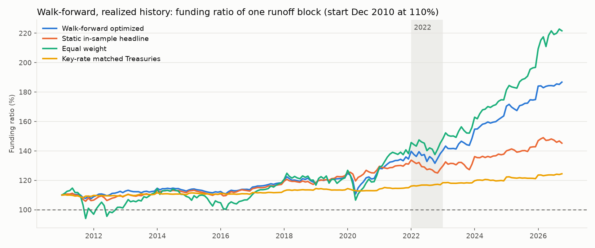
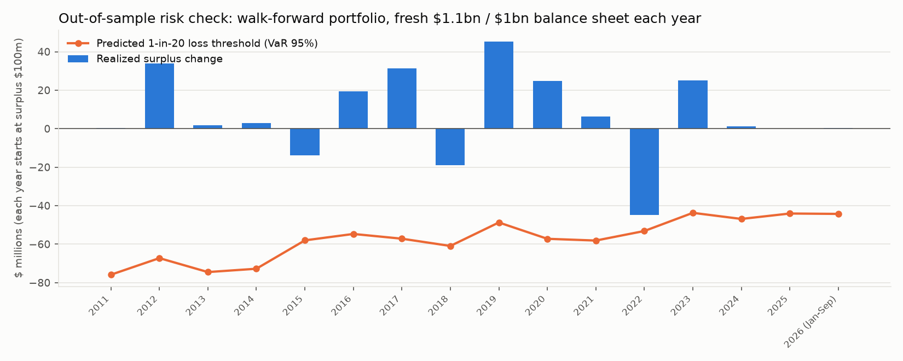

# Walk-forward (out-of-sample) results

Generated by `python -m engine.run_walkforward`. $ millions. Rebalance every December from 2010-12-31 using only data available at that date; each following 12 months evaluated on realized ETF returns and the actual Treasury curve. Synthetic liabilities; capital is a PROXY, not NAIC RBC. Nothing was tuned after seeing these results.

Strategies: walk-forward optimized (full headline process re-run each December with point-in-time data); static in-sample headline (Stage 3b weights, estimated on 2007 to 2026, so it has seen the future); equal weight; key-rate matched Treasuries (re-matched each December, point-in-time).

## Primary view (pre-specified): one liability block runs off from Dec 2010

Assets start at 1,100 against a block worth 1,000 on the Dec 2010 curve; payments each December; no dividends, so surplus accumulates.

|                                | Walk-forward optimized   | Static in-sample headline   | Equal weight        | Key-rate matched Treasuries   |
|:-------------------------------|:-------------------------|:----------------------------|:--------------------|:------------------------------|
| total_surplus_change           | 280.8007532651275        | 98.5666339460592            | 433.7983962520242   | 7.299296007011037             |
| mean_annual_surplus_change     | 18.753378592233275       | 7.5299186920024415          | 26.40737685551021   | 0.4681251738450783            |
| annual_surplus_change_vol      | 35.79941881726979        | 33.29473734366129           | 73.23849461054996   | 5.355076606726901             |
| monthly_surplus_vol_annualized | 39.751472654290694       | 31.169254993610103          | 78.6890913977037    | 7.872893833568703             |
| worst_year                     | 2022                     | 2022                        | 2011                | 2022                          |
| worst_year_change              | -59.83554610577539       | -75.50885153134197          | -134.22117995810902 | -12.751671031583442           |
| surplus_change_2022            | -59.83554610577539       | -75.50885153134197          | -58.4842913349454   | -12.751671031583442           |
| partial_2026_change            | -0.49992561837160565     | -14.382146433977425         | 37.68774341937103   | 0.2774183993348629            |
| start_funding_ratio            | 1.0999999999999999       | 1.0999999999999999          | 1.0999999999999999  | 1.0999999999999999            |
| end_funding_ratio              | 1.8677321297498601       | 1.452474546580824           | 2.216368442722948   | 1.2445033153072567            |
| min_funding_ratio              | 1.0751238904315177       | 1.0579395796712898          | 0.9406917503726392  | 1.0824625162484711            |
| min_funding_ratio_date         | 2011-11-30               | 2011-09-30                  | 2011-09-30          | 2011-08-31                    |
| avg_annual_turnover            | 0.18499955414166103      | 0.024273369419946633        | 0.03587435124053206 | 0.032129597154625954          |

Surplus change by calendar year:

|                |   Walk-forward optimized |   Static in-sample headline |   Equal weight |   Key-rate matched Treasuries |
|:---------------|-------------------------:|----------------------------:|---------------:|------------------------------:|
| 2011           |                      0.3 |                       -26.5 |         -134.2 |                           9.6 |
| 2012           |                     37.4 |                        31.7 |           76.6 |                          -4   |
| 2013           |                     -3.1 |                        16   |           89.9 |                           0.9 |
| 2014           |                     -2.8 |                         3.5 |          -50   |                           3.2 |
| 2015           |                    -18.2 |                       -25.1 |          -39.1 |                          -6.8 |
| 2016           |                     19.2 |                        23.9 |           46.6 |                          -2.6 |
| 2017           |                     35.9 |                        37.7 |           81.7 |                           6   |
| 2018           |                    -27   |                       -19.2 |          -43.7 |                           4   |
| 2019           |                     50.3 |                        54.9 |           79.3 |                           0.8 |
| 2020           |                     32.6 |                        38.6 |           23.6 |                           1.5 |
| 2021           |                     58.6 |                         4.7 |           94.7 |                           1.9 |
| 2022           |                    -59.8 |                       -75.5 |          -58.5 |                         -12.8 |
| 2023           |                     62.6 |                        23.7 |           61.2 |                           1.2 |
| 2024           |                     45.2 |                        -0.3 |           54.6 |                           1.7 |
| 2025           |                     50.2 |                        24.8 |          113.3 |                           2.4 |
| 2026 (Jan-Sep) |                     -0.5 |                       -14.4 |           37.7 |                           0.3 |

Walk-forward decisions (primary view):

| rebalance   | status                                                                                                                                                                 |   surplus |   target |   gap_per_100bp |   capital |   violations | weights                                            |
|:------------|:-----------------------------------------------------------------------------------------------------------------------------------------------------------------------|----------:|---------:|----------------:|----------:|-------------:|:---------------------------------------------------|
| 2010-12-31  | target met                                                                                                                                                             |    100    |    10    |           10    |     16.19 |            0 | IEF 30%, TLT 29%, LQD 40%, GLD 1%                  |
| 2011-12-31  | target below min-variance return: min-variance portfolio                                                                                                               |    100.27 |    10.03 |           11.26 |     16.35 |            0 | IEF 26%, TLT 34%, LQD 40%                          |
| 2012-12-31  | target met                                                                                                                                                             |    137.65 |    13.77 |           10.85 |     33.68 |            0 | SHY 6%, IEF 16%, TLT 33%, LQD 40%, GLD 5%          |
| 2013-12-31  | target met                                                                                                                                                             |    134.59 |    13.46 |            9.21 |     37.35 |            0 | SPY 2%, IEF 20%, TLT 21%, LQD 53%, GLD 5%          |
| 2014-12-31  | target met                                                                                                                                                             |    131.77 |    13.18 |            9.78 |     28.31 |            0 | IEF 32%, TLT 24%, LQD 40%, GLD 4%                  |
| 2015-12-31  | target below min-variance return: min-variance portfolio                                                                                                               |    113.58 |    11.36 |            9.17 |     13.4  |            0 | IEF 41%, TLT 19%, LQD 40%                          |
| 2016-12-31  | target met                                                                                                                                                             |    132.81 |    13.28 |            8.63 |     34.48 |            0 | SPY 2%, IEF 29%, TLT 15%, LQD 49%, GLD 5%          |
| 2017-12-31  | target met                                                                                                                                                             |    168.66 |    16.87 |            8.28 |     58.38 |            0 | SPY 10%, IEF 16%, TLT 14%, LQD 55%, GLD 5%         |
| 2018-12-31  | target met                                                                                                                                                             |    141.65 |    14.17 |            7.65 |     24.63 |            0 | SHY 25%, TLT 22%, LQD 48%, GLD 5%                  |
| 2019-12-31  | target met                                                                                                                                                             |    191.92 |    19.19 |            7.73 |     63.6  |            0 | SPY 10%, SHY 12%, TLT 14%, LQD 57%, VNQ 3%, GLD 5% |
| 2020-12-31  | target met                                                                                                                                                             |    224.49 |    22.45 |            7.98 |     74.21 |            0 | SPY 10%, SHY 13%, TLT 12%, LQD 55%, VNQ 5%, GLD 5% |
| 2021-12-31  | target above max feasible return: max-return portfolio                                                                                                                 |    283.07 |    28.31 |            7.12 |     76    |            0 | SPY 10%, LQD 62%, HYG 5%, TIP 13%, VNQ 5%, GLD 5%  |
| 2022-12-31  | target above max feasible return: max-return portfolio                                                                                                                 |    223.24 |    22.32 |            5.53 |     59.49 |            0 | SPY 10%, SHY 8%, LQD 67%, HYG 5%, VNQ 5%, GLD 5%   |
| 2023-12-31  | target above max feasible return: max-return portfolio                                                                                                                 |    285.83 |    28.58 |            5.22 |     60.34 |            0 | SPY 10%, SHY 20%, LQD 55%, HYG 5%, VNQ 5%, GLD 5%  |
| 2024-12-31  | target above max feasible return: max-return portfolio                                                                                                                 |    331.05 |    33.11 |            4.7  |     58.64 |            0 | SPY 10%, SHY 30%, LQD 45%, HYG 5%, VNQ 5%, GLD 5%  |
| 2025-12-31  | infeasible (constraints are infeasible: The problem is infeasible. (HiGHS Status 8: model_status is Infeasible; primal_status is None)): fell back to key-rate matched |    381.3  |   nan    |          nan    |    nan    |            0 | SHY 59%, IEF 37%, TLT 4%                           |

## Robustness view: fresh balance sheet every December

Each December the balance sheet is reset to assets 1,100 against a new block worth 1,000 on that date's curve, so every year's decision is judged on identical terms (surplus 100 at the start of each year).

|                       |   Walk-forward optimized |   Static in-sample headline |   Equal weight |   Key-rate matched Treasuries |
|:----------------------|-------------------------:|----------------------------:|---------------:|------------------------------:|
| mean surplus change   |                  7.64942 |                     11.6273 |        34.5304 |                     -0.995059 |
| vol of surplus change |                 23.2024  |                     23.9087 |        76.4021 |                      8.02891  |
| worst year change     |                -44.7718  |                    -26.4557 |      -134.221  |                    -25.1334   |
| worst year            |               2022       |                   2011      |      2011      |                   2022        |
| 2022 change           |                -44.7718  |                    -14.375  |        20.6325 |                    -25.1334   |
| years with a loss     |                  3       |                      5      |         5      |                      7        |

Surplus change in each holding year:

|                |   Walk-forward optimized |   Static in-sample headline |   Equal weight |   Key-rate matched Treasuries |
|:---------------|-------------------------:|----------------------------:|---------------:|------------------------------:|
| 2011           |                      0.3 |                       -26.5 |         -134.2 |                           9.6 |
| 2012           |                     33.9 |                        30.3 |           81.5 |                          -3.4 |
| 2013           |                      1.8 |                        17.5 |           85.9 |                           0   |
| 2014           |                      2.9 |                       -12   |          -69.3 |                           2.7 |
| 2015           |                    -13.7 |                       -22.8 |          -37.9 |                          -7   |
| 2016           |                     19.3 |                        24.6 |           52.9 |                          -3.9 |
| 2017           |                     31.4 |                        32.1 |           85.6 |                           7.8 |
| 2018           |                    -19   |                       -17.2 |          -44   |                           4.2 |
| 2019           |                     45.3 |                        46.1 |           78.6 |                          -0.8 |
| 2020           |                     24.7 |                        10.8 |           -7.5 |                           3.8 |
| 2021           |                      6.3 |                        15.4 |          111.6 |                           2.1 |
| 2022           |                    -44.8 |                       -14.4 |           20.6 |                         -25.1 |
| 2023           |                     25.2 |                        34.1 |           75.5 |                           0.1 |
| 2024           |                      1.2 |                        21.9 |           92.8 |                          -3   |
| 2025           |                      0   |                        34.4 |          125.9 |                          -2.1 |
| 2026 (Jan-Sep) |                      0.2 |                         2.8 |           77.4 |                           3.5 |

## Out-of-sample risk calibration (robustness view, walk-forward portfolio)

Predicted at each December from that date's scenarios vs realized next year. Realized losses worse than the predicted 1-in-20 threshold (VaR 95%): 0 of 15 full years (expected about 0.8).

| year           | status                                                   |   pred_mean |   pred_vol |   pred_var95 |   pred_cvar95 |   realized |
|:---------------|:---------------------------------------------------------|------------:|-----------:|-------------:|--------------:|-----------:|
| 2011           | target met                                               |        10   |       50.9 |         75.9 |          99.6 |        0.3 |
| 2012           | target below min-variance return: min-variance portfolio |        11.3 |       47.7 |         67.3 |          92.6 |       33.9 |
| 2013           | target met                                               |        10   |       46.6 |         74.5 |          99.6 |        1.8 |
| 2014           | target met                                               |        10   |       46   |         72.8 |         102.2 |        2.9 |
| 2015           | target below min-variance return: min-variance portfolio |        10.3 |       39.1 |         58   |          83.3 |      -13.7 |
| 2016           | target below min-variance return: min-variance portfolio |        12.5 |       38.9 |         54.7 |          79.8 |       19.3 |
| 2017           | target met                                               |        10   |       38.9 |         57.2 |          84.6 |       31.4 |
| 2018           | target met                                               |        10   |       39.8 |         60.9 |          90.7 |      -19   |
| 2019           | target below min-variance return: min-variance portfolio |        11   |       34.3 |         48.7 |          73.3 |       45.3 |
| 2020           | target met                                               |        10   |       37.8 |         57.2 |          85.8 |       24.7 |
| 2021           | target met                                               |        10   |       37.7 |         58.1 |          84   |        6.3 |
| 2022           | target met                                               |        10   |       36.4 |         53.2 |          82.8 |      -44.8 |
| 2023           | target below min-variance return: min-variance portfolio |        13.5 |       33.6 |         43.7 |          66   |       25.2 |
| 2024           | target below min-variance return: min-variance portfolio |        10.5 |       33.1 |         46.9 |          69.6 |        1.2 |
| 2025           | target below min-variance return: min-variance portfolio |        11.1 |       31.8 |         44.1 |          65.4 |        0   |
| 2026 (Jan-Sep) | target met                                               |        10   |       31.6 |         44.3 |          66.1 |        0.2 |

Walk-forward decisions (robustness view):

| rebalance   | status                                                   |   surplus |   target |   gap_per_100bp |   capital |   violations | weights                                   |
|:------------|:---------------------------------------------------------|----------:|---------:|----------------:|----------:|-------------:|:------------------------------------------|
| 2010-12-31  | target met                                               |       100 |       10 |           10    |     16.19 |            0 | IEF 30%, TLT 29%, LQD 40%, GLD 1%         |
| 2011-12-31  | target below min-variance return: min-variance portfolio |       100 |       10 |           10    |     14.73 |            0 | IEF 25%, TLT 35%, LQD 40%                 |
| 2012-12-31  | target met                                               |       100 |       10 |           10    |     23.91 |            0 | IEF 22%, TLT 35%, LQD 40%, GLD 3%         |
| 2013-12-31  | target met                                               |       100 |       10 |           10    |     34.02 |            0 | SPY 1%, IEF 22%, TLT 32%, LQD 40%, GLD 5% |
| 2014-12-31  | target below min-variance return: min-variance portfolio |       100 |       10 |           10    |     14.8  |            0 | IEF 26%, TLT 34%, LQD 40%                 |
| 2015-12-31  | target below min-variance return: min-variance portfolio |       100 |       10 |           10    |     14.57 |            0 | IEF 27%, TLT 33%, LQD 40%                 |
| 2016-12-31  | target met                                               |       100 |       10 |           10    |     25.38 |            0 | IEF 24%, TLT 33%, LQD 40%, GLD 3%         |
| 2017-12-31  | target met                                               |       100 |       10 |           10    |     35.83 |            0 | SPY 2%, IEF 17%, TLT 36%, LQD 40%, GLD 5% |
| 2018-12-31  | target below min-variance return: min-variance portfolio |       100 |       10 |           10    |     14.57 |            0 | IEF 29%, TLT 31%, LQD 40%                 |
| 2019-12-31  | target met                                               |       100 |       10 |           10    |     31.87 |            0 | SHY 11%, TLT 43%, LQD 40%, GLD 5%         |
| 2020-12-31  | target met                                               |       100 |       10 |           10    |     31.19 |            0 | SHY 10%, TLT 45%, LQD 40%, GLD 5%         |
| 2021-12-31  | target met                                               |       100 |       10 |           10    |     33.08 |            0 | SPY 1%, IEF 17%, TLT 37%, LQD 40%, GLD 5% |
| 2022-12-31  | target below min-variance return: min-variance portfolio |       100 |       10 |           10    |     13.49 |            0 | SHY 11%, IEF 17%, TLT 32%, LQD 40%        |
| 2023-12-31  | target below min-variance return: min-variance portfolio |       100 |       10 |           10    |     13.32 |            0 | SHY 15%, IEF 13%, TLT 32%, LQD 40%        |
| 2024-12-31  | target below min-variance return: min-variance portfolio |       100 |       10 |            9.87 |     12.4  |            0 | SHY 24%, TLT 35%, LQD 40%                 |
| 2025-12-31  | target met                                               |       100 |       10 |           10    |     20.87 |            0 | SHY 22%, TLT 36%, LQD 40%, GLD 3%         |
